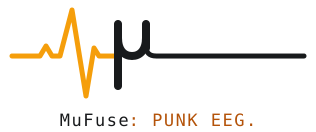

<p align="center">
  <picture>
    <source media="(prefers-color-scheme: dark)" srcset="assets/mufuse-banner-dark.svg">
    <source media="(prefers-color-scheme: light)" srcset="assets/mufuse-banner-light.svg">
    
  </picture>
</p>

> **Punk EEG.** Local-first, open-source software that reads your brain and body signals from a
> consumer headband, notices when something shifts, and helps you journal what actually happened.

## What it is

- A stack for the **Muse S Athena**: EEG, fNIRS optics, heart rate and motion, streamed and
  recorded on your own machine.
- A companion that **describes** signal changes against *your* baseline ("heart rate up, blinks
  doubled vs this morning") and asks what was going on. You name it; it learns from your answers.
- **Local-first by default.** Raw signals never leave your device. Deleting everything takes one
  action.
- Honest about evidence: every interpretation says how strong the science is and how often it has
  been right for you.

## What it is not

- Not mind reading. It can't see your thoughts.
- Not a mental-state labeller. It never tells you "you are anxious".
- Not a medical device, diagnosis or therapy, and not a replacement for professional care.

## Status

**001 acquisition** is shipped: connect, stream, auto-reconnect, crash-safe recording with
markers.

| Command | What it does |
|---|---|
| `mufuse devices` | Scan for nearby Muse headbands |
| `mufuse stream` | Live signal view (`--source sim` works without a headband) |
| `mufuse record` | Record a session with keyboard markers |
| `mufuse inspect` | Summarize a recorded session |

Next up: signal quality, EEG and heart-rate features, experimental fNIRS, then the labelling loop.
See [`docs/ROADMAP.md`](docs/ROADMAP.md).

- Rules: [`.specify/memory/constitution.md`](.specify/memory/constitution.md)
- Brand: [`docs/BRAND.md`](docs/BRAND.md)
- Evidence: [`reports/`](reports/) and [`docs/research/`](docs/research/)

## Setup

Requires Windows 10 (build 19041+) or 11 with Bluetooth, and [uv](https://docs.astral.sh/uv/).

```bash
uv sync
uv run mufuse stream --source sim     # works without a headband
```

## Connecting the Muse S Athena

No Windows pairing is needed. The headband advertises over Bluetooth LE and MuFuse connects
directly. If you previously paired it in Windows settings, remove it there first.

1. Close the Muse app on your phone (or turn phone Bluetooth off). Only one device can be
   connected to the headband at a time.
2. Turn the headband on. Moving or blinking lights mean it is waiting for a connection.
3. `uv run mufuse devices` should list something like `MuseS-XXXX`.
4. Put it on: hair away from the forehead sensors, behind-ear sensors on skin. Slightly
   dampening the sensors helps.
5. `uv run mufuse stream`. The first run scans and remembers your headband. Within about 15 s
   the EEG row should read `ok` for TP9, AF7, AF8, TP10 at roughly 256/52/64 Hz. Press `q` to quit.

Not found? Power-cycle the headband, toggle Windows Bluetooth, make sure the phone isn't
connected, and stay within about 2 m.

## Recording

```bash
uv run mufuse record --notes "deep work" --duration 600
uv run mufuse inspect recordings/<session_id>
```

While recording: `space` drops a moment marker, `1`–`9` start/end numbered blocks, `q` stops.
Recordings stay in `recordings/` on your machine (git-ignored) in an open format described in
[`specs/001-headband-acquisition/contracts/recording-format.md`](specs/001-headband-acquisition/contracts/recording-format.md).

## Development

```bash
uv run ruff format && uv run ruff check && uv run pyright
uv run pytest -m "not hardware"       # CI suite, no headband needed
uv run pytest -m hardware -s          # with the headband on (see tests/hardware/README.md)
```

Features are built with [Spec Kit](https://github.com/github/spec-kit) (`/speckit-specify` →
`/speckit-plan` → `/speckit-tasks` → `/speckit-implement`), test-first, one branch per feature.

---

<sub>MuFuse is an independent, MIT-licensed open-source project and is not affiliated with,
endorsed by, or sponsored by InteraXon Inc. Muse is a trademark of InteraXon Inc.</sub>
